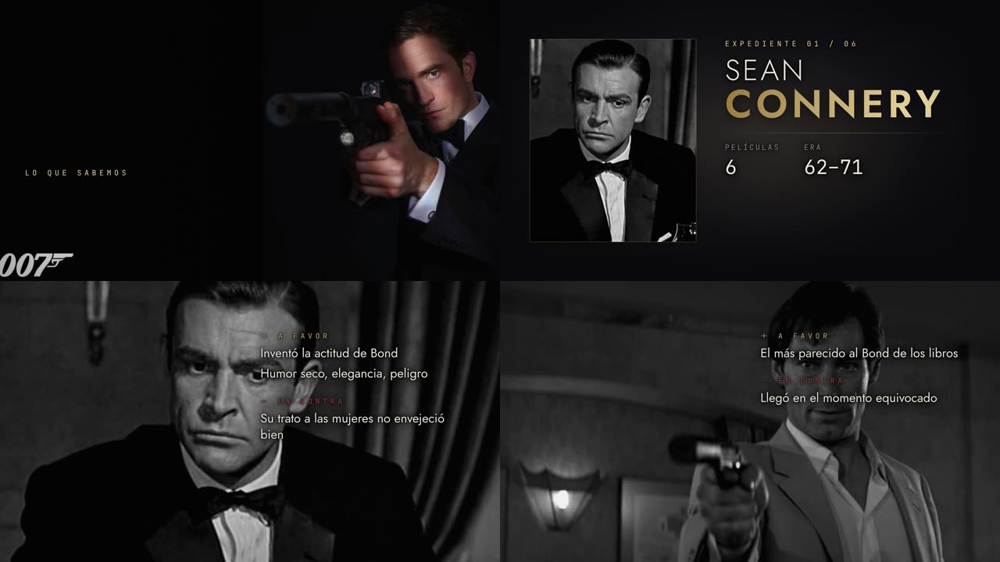
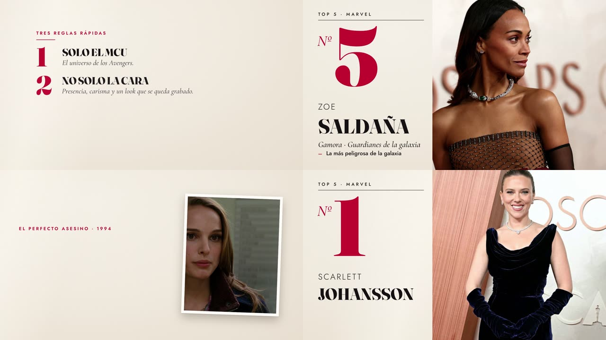
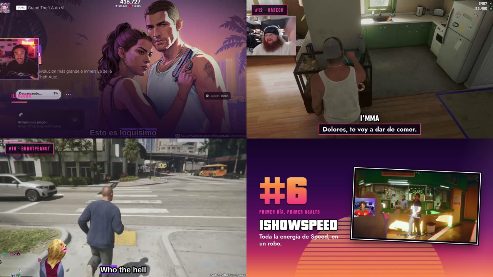

# Galería de estilos

Se elige un estilo por video (`video.json → "estilo"`). Para crear uno nuevo, usa la skill `nuevo-estilo`: un estilo entra a esta tabla solo cuando su preview está aprobado.

| Slug | Nombre | Para qué temas | Voz | Preview |
|---|---|---|---|---|
| `bond` | Esmoquin | cine clásico, espías, sagas de actores, noticias de casting · negro y oro, pausado | narrador-comics |  |
| `portada` | Portada | rankings de personas, celebridades, alfombra roja · revista clara, rojo de acento | narrador-comics |  |
| `leonida` | Leonida sunset | videojuegos, comparativas por épocas, listas de datos · atardecer y Pricedown | narrador-comics |  |
| `facecam` | Facecam Leonida | top de momentos de streamers o clips de gameplay con sonido | narrador-comics |  |

## Pendientes

- **`comic`** (Camino a Doomsday, Marvel/DC): cómic con semitonos, viñetas y onomatopeyas.
  - Corre en otro motor (API de escenas en `content-creator/explicando/_motion/compositions/camino-a-doomsday/_lf/`) y todavía no está portado a este motor.
  - Mientras tanto, un video de cómics se hace con `nuevo-estilo` tomando Doomsday como referencia, o portando ese motor como plugin.
